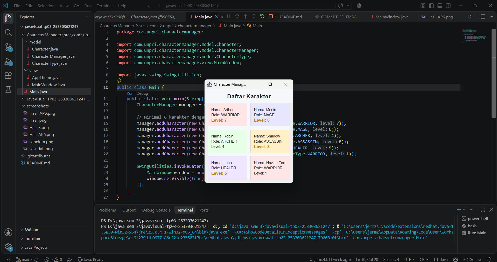

## TP10 - Sprint #4

### Screenshot Perubahan Tampilan
- **Sebelum (v0.3):**  
  
- **Sesudah (v0.4):**  
  

### Mengapa Warna Disimpan di `AppTheme` dan Bukan di `Character`?
Pengaturan warna merupakan bagian dari **View** (antarmuka visual), sedangkan kelas `Character` adalah **Model** yang menangani data dan logika bisnis aplikasi. Menyimpan warna di `Character` akan merusak prinsip *Separation of Concerns* dalam arsitektur MVC, menyebabkan *tight coupling* antara logika data dan komponen GUI, serta menyulitkan pengujian unit (*unit testing*) tanpa dependensi grafik Swing.

### Dua Properti Tambahan yang Dipilih
1. **`setToolTipText(...)` pada Card Karakter**:  
   *Alasan:* Memberikan informasi kontekstual instan mengenai detail nama, tipe, dan level karakter saat kursor diarahkan ke kartu tanpa mengotori tata letak teks utama.
2. **`setEnabled(false)` untuk Karakter Level 1**:  
   *Alasan:* Memberikan petunjuk visual bahwa karakter level 1 masih berada pada status *novice*/terkunci dari fitur lanjutan tertentu.

### Analisis Properti & MVC (Google Docs)
[Link Google Docs Analisis Bagian D](https://docs.google.com/document/d/1TC5zafaUPbtXqQ1XZrAX4MIDeppIzpAcMZiVUbdTkuQ/edit?usp=drivesdk&ouid=102689970742052705979)