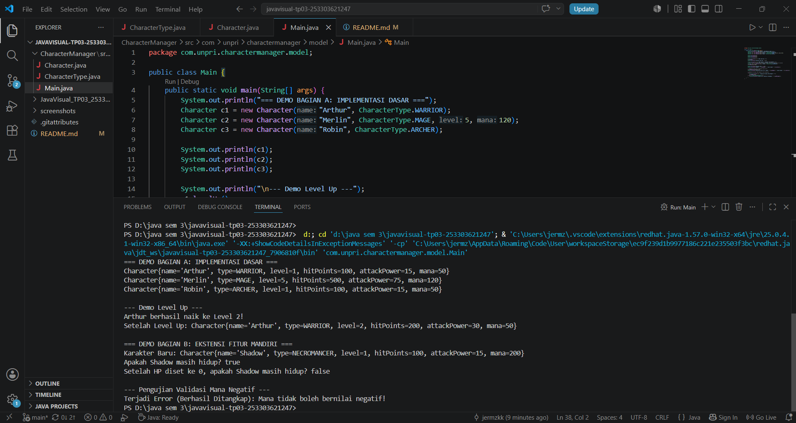

# Character Manager — TP3 (Java Visual SIH-6406)

Aplikasi **Character Manager** adalah sistem pengelolaan karakter game berbasis Pemrograman Berbasis Objek (OOP) menggunakan bahasa Java. Proyek ini mendemonstrasikan penerapan enkapsulasi, validasi status karakter (seperti mana dan HP), serta penggunaan enum.

## Screenshot Output Terminal


## Struktur Folder Project
```text
javavisual-tp03-253303621247/
├── CharacterManager/
│   └── src/
│       └── com/
│           └── unpri/
│               └── charactermanager/
│                   └── model/
│                       ├── CharacterType.java
│                       ├── Character.java
│                       └── Main.java
├── screenshots/
│   └── output.png
└── README.md