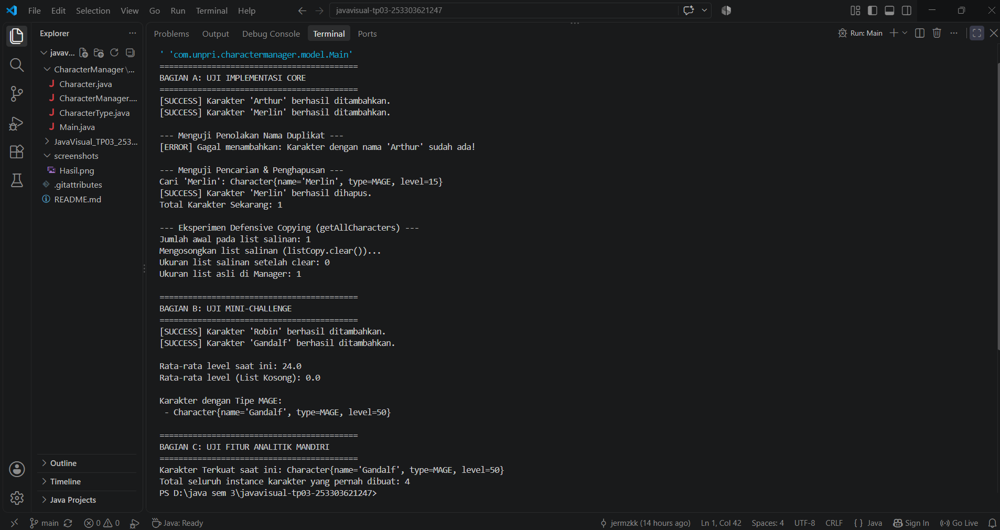
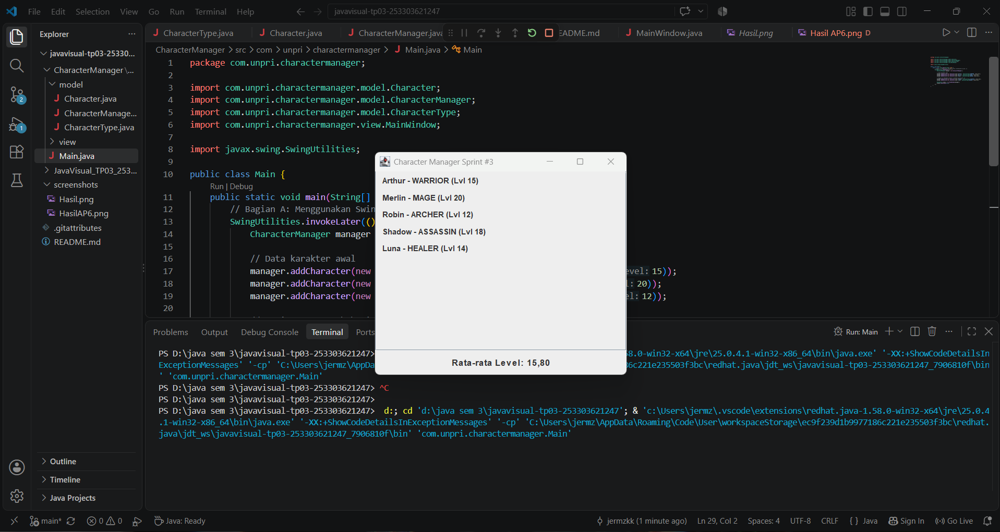

# Character Manager — TP3 (Java Visual SIH-6406)

Aplikasi **Character Manager** adalah sistem pengelolaan karakter game berbasis Pemrograman Berbasis Objek (OOP) menggunakan bahasa Java. Proyek ini mendemonstrasikan penerapan enkapsulasi, validasi status karakter (seperti mana dan HP), serta penggunaan enum.

## Screenshot Output Terminal


## Struktur Folder Project
```text
javavisual-tp03-253303621247/
├── CharacterManager/
│   └── src/
│       └── com/
│           └── unpri/
│               └── charactermanager/
│                   └── model/
│                       ├── CharacterType.java
│                       ├── Character.java
│                       └── Main.java
├── screenshots/
│   └── output.png
└── README.md

## Identitas Mahasiswa
- **Nama Lengkap:** Yeremia Mesakh S. Kembaren
- **NIM:** 253303621247
- **Kelas:** Semester 3 PAGI A
- **Dokumen Analisis Desain (Bagian D):** [Link Google Docs Bagian D](https://docs.google.com/document/d/1MQDKatzEaXfBc7buEQOPOUtTC96TufAhxZ9xtd9hWFg/edit?usp=sharing)


# JavaVisual — TP05: 
Proyek ini menggabungkan implementasi `CharacterManager` dari AP6 dengan analisis konseptual mengenai *Reference*, *Encapsulation*, dan *Defensive Copying* pada Java.

---

## 1. Implementasi & Fitur Proyek

### A. Core Features (Bagian A)
- **Override `equals()` & `hashCode()`:** Memastikan pembandingan dua objek `Character` dilakukan berbasis nama karakter (case-insensitive).
- **CRUD `CharacterManager`:** Menyediakan fungsi `addCharacter()`, `findByName()`, `removeCharacter()`, `getTotalCharacters()`, dan `getAllCharacters()`.
- **Penolakan Duplikat:** Otomatis menolak penambahan karakter jika nama karakter sudah ada di dalam manager.
- **Defensive Copying:** Method `getAllCharacters()` mengembalikan salinan baru (*deep copy*) dari list sehingga data utama di dalam `CharacterManager` aman dari manipulasi eksternal.

### B. Mini-Challenge (Bagian B)
- **`getAverageLevel()`:** Menghitung rata-rata level karakter, dilengkapi penanganan *edge case* untuk mengembalikan `0.0` jika daftar kosong (mencegah error pembagian dengan nol).
- **`findByType(CharacterType type)`:** Mengembalikan `ArrayList` baru berisi seluruh karakter sesuai tipe yang dicari.

---

## 2. Fitur Analitik Mandiri (Bagian C)

### Method `findStrongest()`
- **Deskripsi:** Mencari dan mengembalikan karakter dengan level tertinggi di dalam `CharacterManager`.
- **Enkapsulasi:** Method mengembalikan *defensive copy* dari objek karakter terkuat sehingga pihak luar tidak dapat mengubah state objek asli di dalam manager secara langsung.
- **Rasionalitas:** Fitur ini sangat penting pada game/sistem RPG untuk menentukan karakter utama/terkuat dalam tim secara efisien tanpa merusak struktur data internal.

---

## 3. Hasil Pengujian Program

Berikut adalah screenshot hasil eksekusi program `Main.java` yang mencakup pengujian CRUD, penolakan nama duplikat, pengujian edge case, dan bukti eksperimen *Defensive Copying*:

## Screenshot Output Terminal


## 4. Dokumen Analisis (Bagian D)

Analisis konseptual mendalam (minimal 500 kata) mengenai *Reference Memory*, *Primitive vs Reference Value*, *Keyword Static*, *Equals Method*, dan *Encapsulation Risk* telah disusun pada Google Docs berikut:

🔗 **Link Google Docs:** [JavaVisual_TP05_253303621247_Yeremia Mesakh S. Kembaren](https://docs.google.com/document/d/1Q_mh1oaMfYn4Nc5uvbogwSw6kZ278mL0wGoQfhVToU4/edit?usp=sharing)

# TP8 - Character Manager Sprint #3

## Screenshot Aplikasi



## Aliran Data (Main -> CharacterManager -> MainWindow)
Data diawali di `Main` dengan menginstansiasi `CharacterManager` dan menambahkan beberapa objek `Character`. Objek `CharacterManager` yang menampung daftar data tersebut kemudian diteruskan ke konstruktor `MainWindow`. Di dalam `MainWindow`, data diiterasi secara dinamis untuk membangun komponen visual UI (JLabel). Dalam pola MVC, `Main` bertindak sebagai pengatur awal, `CharacterManager` sebagai Model, dan `MainWindow` sebagai View.

## Daftar Karakter Baru
1. **Shadow (ASSASSIN, Level 18):** Dipilih untuk menambah variasi tipe petarung jarak dekat dengan tingkat kecepatan tinggi serta menaikkan rata-rata level tim.
2. **Luna (HEALER, Level 14):** Dipilih untuk melengkapi peran pendukung (support) dalam tim agar komposisi tipe karakter seimbang.

## Dokumen Analisis (Bagian D)
[Dokumen Analisis GUI & MVC - Google Docs](https://docs.google.com/document/d/14EX5tiufCEO7KzcD3NU9e-rfu9R4p5NbmbwNcC3ZSJk/edit)