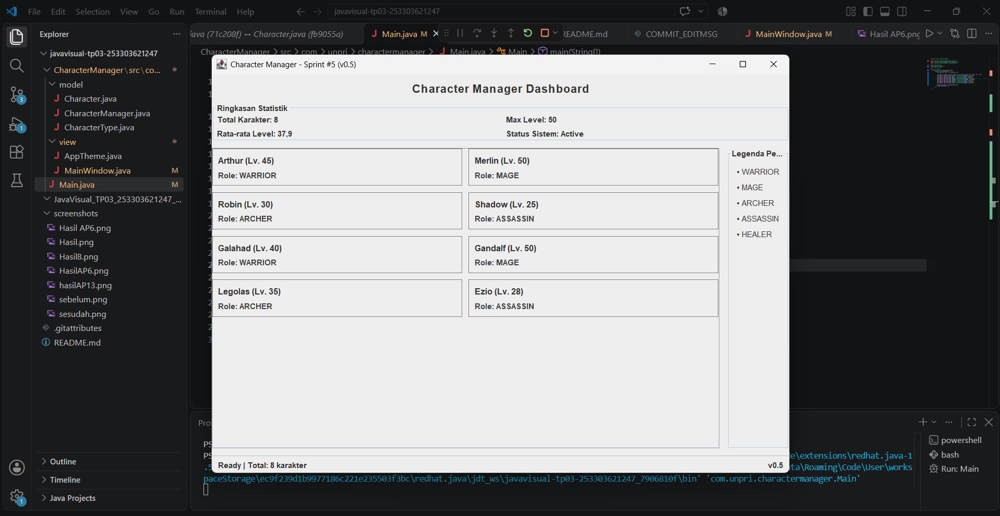
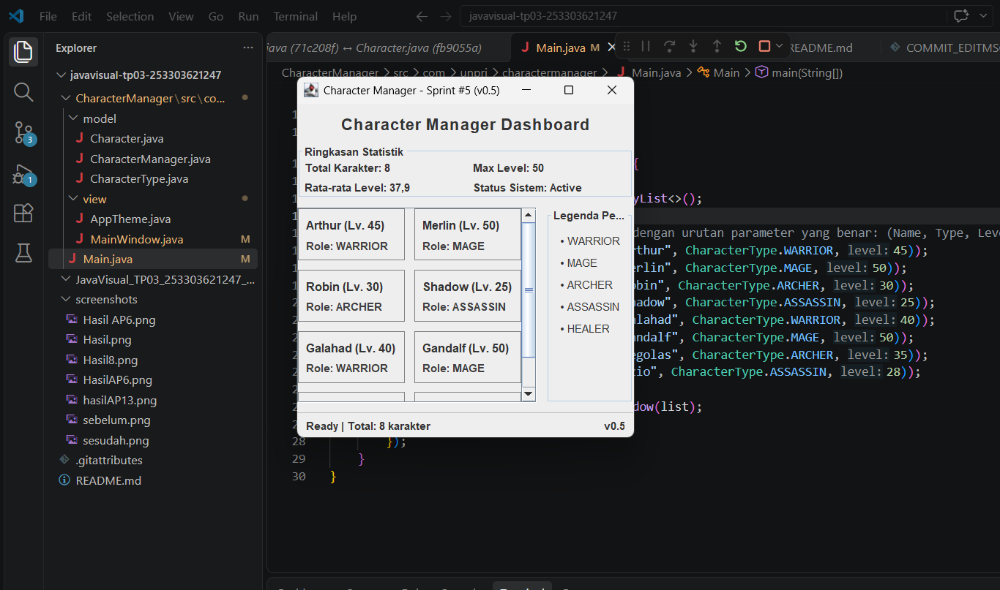
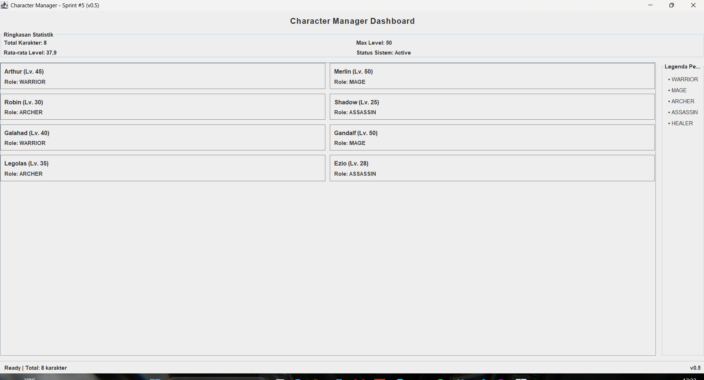

## TP12 - Sprint #5

### Screenshot Perubahan Tampilan (v0.5)
- **Ukuran Awal (v0.5):**
  
- **Ukuran Kecil / Scrollbar (v0.5):**
  
- **Ukuran Besar / Maximized (v0.5):**
  

### Mengapa Seluruh Kode Layout Wajib Berada di Package `view`?
Seluruh penataan antarmuka wajib diisolasi di package `view` untuk menerapkan prinsip arsitektur **Model-View-Controller (MVC)** dan *Separation of Concerns* (SoC). Package `model` bertindak murni mengelola logika bisnis dan data aplikasi tanpa ketergantungan pada pustaka grafis Swing (`javax.swing.*` / `java.awt.*`)[cite: 1]. Dengan pemisahan ini, perubahan komponen UI (misalnya mengganti daftar `JLabel` menjadi `JTable`) hanya dilakukan di package `view` tanpa mengubah atau mengomputasi ulang struktur kelas pada package `model`, menjaga modularitas dan mempermudah pengujian unit (*unit testing*)[cite: 2].

### Dua Perubahan Layout & Komponen yang Dipilih
1. **`GridLayout(2, 2)` pada Panel Statistik (NORTH):**
   *Alasan:* Memberikan proporsi grid simetris 2x2 yang konsisten untuk menampilkan 4 indikator matriks statistik di bawah header utama tanpa terpengaruh perubahan lebar jendela[cite: 2].
2. **`BoxLayout(Y_AXIS)` pada Legenda Peran (EAST):**
   *Alasan:* Menyusun daftar tipe karakter secara linier vertikal dari atas ke bawah[cite: 1]. Penggunaan `Box.createVerticalStrut()` menjaga spasi antar-item tetap konsisten, sedangkan `Box.createVerticalGlue()` mendorong seluruh legenda ke atas agar tidak merenggang saat tinggi jendela ditambah[cite: 1].

---

### Wireframe Layout
```text
+-------------------------------------------------------------------+
|                        [ NORTH: Header ]                          |
| +---------------------------------------------------------------+ |
| | Panel Statistik (GridLayout 2x2):                             | |
| | Total Karakter: 8             | Max Level: 50                 | |
| | Rata-rata Level: 37.9         | Status Sistem: Active         | |
| +---------------------------------------------------------------+ |
+---------------------------------+---------------------------------+
|                                 | [ EAST: Legenda ]               |
| [ CENTER: JScrollPane ]         | - BoxLayout (Y_AXIS)            |
| +-----------------------------+ | - CharacterType.values()        |
| | JPanel (Card Container)     | | - Strut & Glue                |
| | - Grid Cards (2 Kolom)      | |                               |
| +-----------------------------+ |                               |
+---------------------------------+---------------------------------+
| [ SOUTH: Status Bar ]                                             |
| Status: Ready | Total: 8        | Version: v0.5                   |
+-------------------------------------------------------------------+

docsnya : https://docs.google.com/document/d/1lKIJ4o8LpoJ9UNDYphzXCj8w4Hn1pg1wlQkOl9U0wMw/edit?usp=sharing